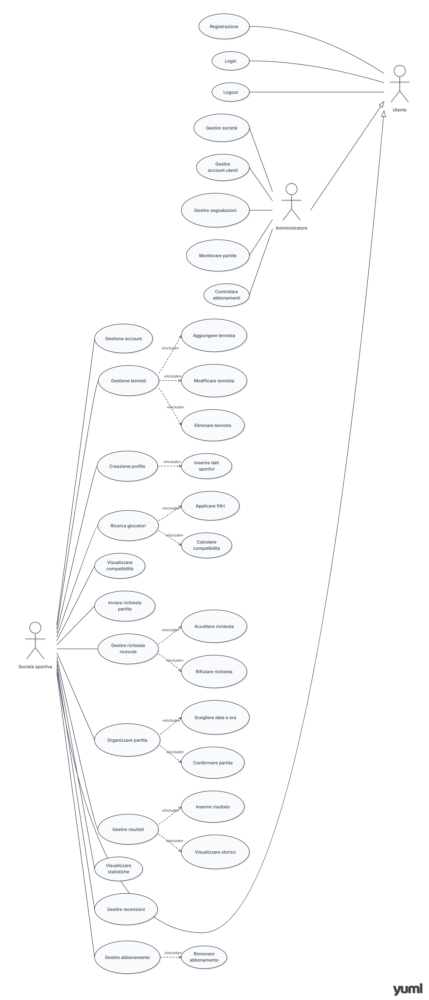

## **TENNISMATCH**

Tagline: *“Trova il tuo avversario. Gioca la tua partita.”*

Descrizione del Progetto:
TennisMatch è un'applicazione web rivolta alle società di tennis che permette di trovare e mettere in contatto tennisti compatibili appartenenti a realtà diverse, basandosi su livello, zona, disponibilità e preferenze di gioco. La società sportiva opera come intermediario tra i giocatori e sfrutta la piattaforma per organizzare nuovi match. Ogni tennista ha inoltre la possibilità di visualizzare il proprio storico e il record aggiornato delle partite.

Problema:
Le società sportive riscontrano spesso difficoltà nel trovare avversari adatti per i propri tennisti tesserati. Risulta complesso individuare giocatori che siano simultaneamente allo stesso livello tecnico, disponibili nei medesimi orari e situati in zone geografiche limitrofe.

Target: 
Società di tennis e tennisti amatoriali (principianti e intermedi) iscritti alle società stesse.

Competitors: 
Playtomic, TennisPal, Tennis Buddy.


## **ELENCO DELLE FUNZIONALITA'**

#### 1. Registrazione e accesso della società
> * Registrazione della società tramite nome, email e password
> * Login e logout
> * Modifica dei dati della società
> * Eliminazione dell'account della società

#### 2. Gestione dei tennisti
> * Aggiunta di nuovi tennisti appartenenti alla società
> * Modifica dei dati dei tennisti
> * Eliminazione di un tennista dalla società
> * Visualizzazione dell'elenco dei propri tennisti
> * Visualizzazione del profilo del tennista

#### 3. Creazione del profilo del tennista
> * Inserimento dei parametri: livello di gioco, stile di gioco, superficie preferita, zona in cui gioca, giorni e orari disponibili, obiettivo della partita
> * Visualizzazione dei dettagli del profilo

#### 4. Ricerca di giocatori
> * Ricerca avanzata basata su: livello di gioco, superficie, zona, disponibilità, stile di gioco, obiettivo della partita
> * Visualizzazione dei profili dei giocatori trovati
> * Ordinamento dinamico dei risultati in base alla compatibilità
> * Utilizzo di filtri di ricerca rapidi

#### 5. Confronto e compatibilità
> * Confronto incrociato dei parametri dei giocatori (livello, superficie preferita, zona, disponibilità, stile, obiettivo)
> * Calcolo automatico della percentuale di compatibilità
> * Ordinamento decrescente dal giocatore più compatibile a quello meno compatibile

#### 6. Visualizzazione dei profili
> * Scheda dettagliata con: nome, società di appartenenza, livello, superficie preferita, stile di gioco, obiettivo, zona, disponibilità
> * Storico e risultati delle partite (record di vittorie e sconfitte)
> * Recensioni storiche ricevute e valutazione media

#### 7. Richieste di partita
> * Invio di una richiesta di match per un proprio tennista
> * Ricezione e gestione delle richieste in entrata da altre società
> * Visualizzazione e monitoraggio dei pannelli "Richieste inviate" e "Richieste ricevute"
> * Azioni di accettazione o rifiuto delle richieste
> * Tracciamento dello stato della richiesta

#### 8. Notifiche del sistema
> * Invio di alert automatici quando: si riceve una nuova richiesta, una richiesta viene accettata/rifiutata, una partita viene confermata, modificata o annullata

#### 9. Organizzazione della partita
> * Definizione dei dettagli logistici: scelta della data, dell'orario e del luogo dell'incontro
> * Conferma ufficiale della partita programmata
> * Modifica dei dati o annullamento dell'evento
> * Monitoraggio dello stato attuale del match

#### 10. Gestione delle partite e dei risultati
> * Inserimento del risultato finale a match concluso
> * Passaggio di stato della partita a "completata"
> * Aggiornamento automatico del record e delle statistiche del tennista (vittorie/sconfitte)
> * Visualizzazione dello storico pubblico e privato delle partite

#### 11. Sistema di Recensioni
> * Possibilità di lasciare un voto numerico e un commento testuale post-partita
> * Visualizzazione del feed delle recensioni e calcolo in tempo reale della valutazione media

#### 12. Abbonamento della società
> * Monitoraggio del piano attuale, della data di inizio e di scadenza
> * Funzioni di attivazione, rinnovo manuale o annullamento del piano di abbonamento

#### 13. Gestione amministratore (Pannello Admin)
> * Monitoraggio globale di società e tennisti iscritti sulla piattaforma
> * Controllo e gestione degli account (sospensione o eliminazione in caso di violazioni)
> * Supervisione delle partite organizzate e controllo dello stato dei pagamenti degli abbonamenti
> * Modulo per la gestione e la risoluzione delle segnalazioni degli utenti

#### 14. Sicurezza e controlli
> * Validazione e sanificazione dei dati in input
> * Cifratura e memorizzazione sicura delle password
> * Controllo degli accessi basato sui ruoli (RBAC): separazione netta tra i permessi delle società e degli amministratori
> * Gestione centralizzata dei messaggi di errore e prevenzione degli accessi a risorse non autorizzate


## **CLASSIFICAZIONE DELLE FUNZIONALITÀ (REQUISITI)**
```text
Registrazione della società con nome, email e password → Funzionale
Login e logout → Funzionale
Modifica dei dati della società → Funzionale
Eliminazione dell'account della società → Funzionale
Aggiunta di un tennista alla società → Funzionale
Modifica dei dati di un tennista → Funzionale
Eliminazione di un tennista dalla società → Funzionale
Visualizzazione dell'elenco dei propri tennisti → Funzionale
Creazione del profilo del tennista → Funzionale
Inserimento del livello di gioco → Di dominio
Inserimento dello stile di gioco → Di dominio
Inserimento della superficie preferita → Di dominio
Inserimento della zona in cui gioca → Di dominio
Inserimento dei giorni e degli orari disponibili → Di dominio
Inserimento dell'obiettivo della partita → Di dominio
Visualizzazione del profilo del tennista → Funzionale
Ricerca di giocatori appartenenti ad altre società → Funzionale
Ricerca in base a livello, superficie, zona e disponibilità → Di dominio
Utilizzo dei filtri di ricerca → Funzionale
Visualizzazione dei profili degli altri giocatori → Funzionale
Confronto dei dati tra i giocatori → Di dominio
Calcolo della percentuale di compatibilità → Di dominio
Ordinamento dei giocatori per compatibilità → Di dominio
Visualizzazione della percentuale di compatibilità → Funzionale
Invio di una richiesta di partita → Funzionale
Ricezione di una richiesta di partita → Funzionale
Accettazione o rifiuto di una richiesta → Funzionale
Visualizzazione dello stato della richiesta → Funzionale
Notifiche relative alle richieste di partita → Funzionale
Scelta della data, dell'ora e del luogo della partita → Di dominio
Conferma della partita → Funzionale
Modifica dei dati della partita → Funzionale
Annullamento della partita → Funzionale
Visualizzazione dello stato della partita → Funzionale
Inserimento del risultato della partita → Di dominio
Visualizzazione del risultato → Funzionale
Visualizzazione dello storico delle partite → Funzionale
Aggiornamento delle vittorie e delle sconfitte → Di dominio
Visualizzazione delle statistiche di vittorie e sconfitte → Funzionale
Inserimento di un voto e di un commento dopo una partita → Di dominio
Visualizzazione delle recensioni → Funzionale
Visualizzazione della valutazione media → Funzionale
Gestione dell'abbonamento annuale della società → Funzionale
Visualizzazione del piano attuale → Funzionale
Visualizzazione data inizio e scadenza dell'abbonamento → Funzionale
Rinnovo dell'abbonamento → Funzionale
Annullamento dell'abbonamento → Funzionale
Visualizzazione delle società registrate → Funzionale
Gestione degli account da parte dell'amministratore → Funzionale
Sospensione o eliminazione di un account → Funzionale
Visualizzazione delle partite da parte dell'amministratore → Funzionale
Gestione delle segnalazioni → Funzionale
Controllo e validazione dei dati inseriti → Non funzionale
Password memorizzate in modo sicuro → Non funzionale
Protezione dei dati degli utenti → Non funzionale
Separazione dei permessi tra società e amministratori → Non funzionale
Controllo degli accessi alle funzionalità → Non funzionale
Gestione dei messaggi di errore → Non funzionale
```


## **ATTORI**

* **Società Sportiva**: Utilizza la piattaforma, gestisce i profili dei propri tennisti e cerca avversari appartenenti ad altre società.
* **Tennista**: È il giocatore associato a una società; i suoi dati e preferenze vengono utilizzati dal sistema per trovare avversari compatibili.
* **Amministratore**: Gestisce le società, controlla gli account, monitora le partite e gestisce le segnalazioni all'interno della piattaforma.


## **USER STORIES**

Il formato standard utilizzato per definire i requisiti è: “As a [who], I want [what], so that [why].”

**Gestione Società & Account**
* Registrazione della società:
  > As a tennis club, I want to register on TennisMatch, so that I can use the platform to find opponents for my players.
* Login e logout:
  > As a registered tennis club, I want to log in and log out, so that I can securely access my club account.
* Gestione dell'account:
  > As a tennis club, I want to modify or delete my account data, so that I can keep my information updated or remove my account.

**Gestione & Profili dei Tennisti**
* Gestione dei tennisti:
  > As a tennis club, I want to add and manage my players, so that I can keep their information updated on the platform.
* Creazione del profilo del tennista:
  > As a tennis club, I want to create a profile for each player, so that I can provide the information needed to find compatible opponents.
* Visualizzazione del profilo:
  > As a tennis club, I want to view my players' profiles, so that I can check their information and preferences.

**Ricerca & Compatibilità**
* Ricerca di giocatori:
  > As a tennis club, I want to search for players from other clubs, so that I can find suitable opponents for my players.
* Filtri di ricerca:
  > As a tennis club, I want to filter players by level, surface, location and availability, so that I can find opponents with characteristics suitable for my players.
* Visualizzazione dei profili esterni:
  > As a tennis club, I want to view the profiles of players from other clubs, so that I can evaluate potential opponents.
* Compatibilità:
  > As a tennis club, I want to see the compatibility percentage between players, so that I can quickly identify the most suitable opponents.
* Ordinamento dei risultati:
  > As a tennis club, I want to sort the search results by compatibility, so that I can see the most suitable opponents first.

**Organizzazione & Stato Partite**
* Invio di una richiesta:
  > As a tennis club, I want to send a match request for one of my players, so that I can propose a match to another club.
* Gestione delle richieste:
  > As a tennis club, I want to accept or reject received match requests, so that I can decide whether to organize the proposed match.
* Stato della richiesta:
  > As a tennis club, I want to view the status of my match requests, so that I know whether they have been accepted or rejected.
* Notifiche:
  > As a tennis club, I want to receive notifications about match requests, so that I know when I receive a new request or when one of my requests receives a response.
* Organizzazione della partita:
  > As a tennis club, I want to choose the date, time and location of a match, so that I can organize the match between the two players.
* Conferma della partita:
  > As a tennis club, I want to confirm a match, so that both clubs know that the match has been scheduled.
* Annullamento della partita:
  > As a tennis club, I want to cancel a scheduled match, so that I can notify the other club if the match cannot take place.
* Stato della partita:
  > As a tennis club, I want to view the status of my matches, so that I know which matches are scheduled, completed or cancelled.

**Risultati, Statistiche & Recensioni**
* Inserimento del risultato:
  > As a tennis club, I want to enter the result of a completed match, so that the result is saved on the platform.
* Visualizzazione del risultato:
  > As a tennis club, I want to view the results of my players' matches, so that I can keep track of their performance.
* Storico delle partite:
  > As a tennis club, I want to view the match history of my players, so that I can check their previous matches and results.
* Statistiche:
  > As a tennis club, I want to view my players' wins and losses, so that I can monitor their performance.
* Recensioni:
  > As a tennis club, I want to leave a rating and comment after a match, so that I can give feedback about the opponent.
* Visualizzazione delle recensioni:
  > As a tennis club, I want to view the reviews and average rating of other players, so that I can evaluate potential opponents.

**Gestione Abbonamenti**
* Abbonamento:
  > As a tennis club, I want to view and manage my subscription, so that I can use the TennisMatch services.
* Informazioni sull'abbonamento:
  > As a tennis club, I want to view the start and expiration date of my subscription, so that I know how long I can use the platform.
* Rinnovo dell'abbonamento:
  > As a tennis club, I want to renew my subscription, so that I can continue using TennisMatch.
* Annullamento dell'abbonamento:
  > As a tennis club, I want to cancel my subscription, so that I can stop using the paid service.

**Pannello di Amministrazione (Admin)**
* Gestione delle società:
  > As a TennisMatch administrator, I want to view and manage registered tennis clubs, so that I can control the organizations using the platform.
* Gestione degli account:
  > As a TennisMatch administrator, I want to suspend or delete accounts, so that I can take action against accounts that violate the rules.
* Gestione delle partite:
  > As a TennisMatch administrator, I want to view the matches organized on the platform, so that I can monitor the activity of the platform.
* Gestione delle segnalazioni:
  > As a TennisMatch administrator, I want to manage reports, so that I can handle problems or inappropriate behavior on the platform.
  
## **USE CASE DIAGRAM (UML)**
```text
[Società sportiva]^[Utente]
[Amministratore]^[Utente]
[Utente]-(Login)
[Utente]-(Logout)
(Logout)>(Login)
(Login)>(Registrazione)
[Società sportiva]-(Gestione account)
[Società sportiva]-(Gestione tennisti)
[Società sportiva]-(Creazione profilo)
[Società sportiva]-(Ricerca giocatori)
[Società sportiva]-(Visualizzare compatibilità)
[Società sportiva]-(Inviare richiesta partita)
[Società sportiva]-(Gestione richieste ricevute)
[Società sportiva]-(Organizzare partita)
[Società sportiva]-(Gestire risultati)
[Società sportiva]-(Visualizzare statistiche)
[Società sportiva]-(Gestire recensioni)
[Società sportiva]-(Gestire abbonamento)
[Società sportiva]-(Monitorare partite)
(Gestione tennisti)<(Aggiungere tennista)
(Gestione tennisti)<(Modificare tennista)
(Gestione tennisti)<(Eliminare tennista)
(Creazione profilo)>(Inserire dati sportivi)
(Ricerca giocatori)>(Applicare filtri)
(Ricerca giocatori)>(Calcolare compatibilità)
(Gestione richieste ricevute)<(Accettare richiesta)
(Gestione richieste ricevute)<(Rifiutare richiesta)
(Organizzare partita)>(Scegliere data e ora)
(Organizzare partita)>(Confermare partita)
(Gestire risultati)>(Inserire risultato)
(Gestire risultati)<(Visualizzare storico)
(Gestire abbonamento)<(Rinnovare abbonamento)
[Amministratore]-(Gestire società)
[Amministratore]-(Gestire account utenti)
[Amministratore]-(Gestire segnalazioni)
[Amministratore]-(Controllare abbonamenti)
```



