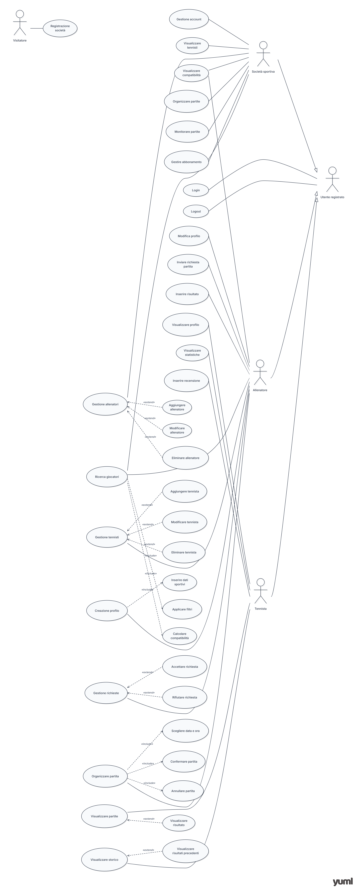
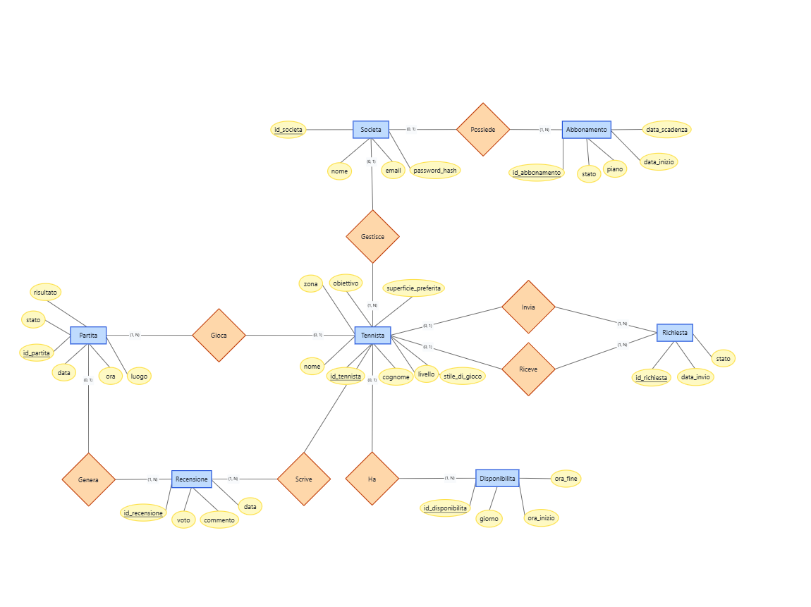

## **TENNISMATCH**

**Tagline:** “TennisMatch: Trova il tuo avversario, il prossimo set inizia qui!”

**Descrizione del Progetto:** TennisMatch è un'applicazione web rivolta alle società tennistiche che permette di gestire i propri tennisti e organizzare partite tra giocatori appartenenti alla stessa società. Ogni allenatore può inserire e gestire i tennisti che segue, creando per ciascuno un profilo con le proprie caratteristiche e disponibilità. La società può utilizzare la piattaforma per trovare giocatori compatibili in base a livello, zona, disponibilità e preferenze di gioco, facilitando l'organizzazione delle partite. Ogni tennista può inoltre visualizzare il proprio storico e il record aggiornato delle partite.

**Problema:** Le società tennistiche riscontrano spesso difficoltà nell'organizzare partite tra i propri iscritti. Risulta complicato individuare giocatori che abbiano un livello tecnico simile, disponibilità negli stessi orari e preferenze compatibili. TennisMatch vuole semplificare questo processo automatizzando la ricerca dei giocatori più adatti.

**Target:** Società e circoli di tennis, allenatori e tennisti amatoriali (principianti e intermedi) iscritti alle società stesse.

**Competitors:** Playtomic, TennisPal, Tennis Buddy.


## **ELENCO DELLE FUNZIONALITA'**

**1. Registrazione e accesso della società**
> * Registrazione della società tramite nome, email e password
> * Login
> * Logout
> * Modifica dei dati della società
> * Eliminazione dell'account della società

**2. Gestione degli allenatori**
> * Aggiunta di nuovi allenatori alla società
> * Modifica dei dati degli allenatori
> * Eliminazione di un allenatore
> * Visualizzazione dell'elenco degli allenatori
> * Assegnazione dei tennisti ai rispettivi allenatori

**3. Gestione dei tennisti**
> * Aggiunta di nuovi tennisti da parte degli allenatori
> * Modifica dei dati dei tennisti
> * Eliminazione di un tennista dalla società
> * Visualizzazione dell'elenco dei propri tennisti
> * Visualizzazione del profilo del tennista

**4. Creazione del profilo del tennista**
> * Inserimento dei parametri: livello di gioco, stile di gioco, superficie preferita, zona in cui gioca, giorni e orari disponibili, obiettivo della partita
> * Inserimento dei dati personali del tennista
> * Visualizzazione dei dettagli del profilo

**5. Ricerca di giocatori**
> * Ricerca di tennisti appartenenti alla stessa società
> * Ricerca basata su: livello di gioco, superficie, zona, disponibilità, stile di gioco, obiettivo della partita
> * Visualizzazione dei profili dei giocatori trovati
> * Ordinamento dinamico dei risultati in base alla compatibilità
> * Utilizzo di filtri di ricerca rapidi

**6. Confronto e compatibilità**
> * Confronto incrociato dei parametri dei giocatori (livello, superficie preferita, zona, disponibilità, stile, obiettivo)
> * Calcolo automatico della percentuale di compatibilità
> * Ordinamento decrescente dal giocatore più compatibile a quello meno compatibile

**7. Visualizzazione dei profili**
> * Scheda dettagliata con: nome, allenatore, livello, superficie preferita, stile di gioco, obiettivo, zona, disponibilità
> * Storico e risultati delle partite (record di vittorie e sconfitte)
> * Visualizzazione delle statistiche personali

**8. Richieste di partita**
> * Invio di una richiesta di match per un proprio tennista
> * Ricezione e gestione delle richieste di partita
> * Visualizzazione dei pannelli "Richieste inviate" e "Richieste ricevute"
> * Azioni di accettazione o rifiuto delle richieste
> * Tracciamento dello stato della richiesta

**9. Notifiche del sistema**
> * Invio di alert automatici quando: si riceve una nuova richiesta, una richiesta viene accettata/rifiutata, una partita viene confermata, modificata o annullata

**10. Organizzazione della partita**
> * Definizione dei dettagli logistici: scelta della data, dell'orario e del luogo dell'incontro
> * Conferma ufficiale della partita programmata
> * Modifica dei dati o annullamento dell'evento
> * Monitoraggio dello stato attuale del match

**11. Gestione delle partite e dei risultati**
> * Inserimento del risultato finale a match concluso
> * Passaggio di stato della partita a "completata"
> * Aggiornamento automatico del record e delle statistiche del tennista (vittorie/sconfitte)
> * Visualizzazione dello storico delle partite

**12. Sistema di Recensioni**
> * Possibilità di lasciare un voto numerico e un commento post-partita
> * Visualizzazione delle recensioni ricevute
> * Calcolo e visualizzazione della valutazione media

**13. Abbonamento della società**
> * Monitoraggio del piano attuale, della data di inizio e di scadenza
> * Funzioni di attivazione, rinnovo manuale o annullamento del piano di abbonamento

**14. Gestione amministratore**
> * Monitoraggio globale delle società registrate sulla piattaforma
> * Controllo e gestione degli account (sospensione o eliminazione in caso di violazioni)
> * Supervisione delle partite organizzate e controllo dello stato dei pagamenti degli abbonamenti
> * Modulo per la gestione e la risoluzione delle segnalazioni delle società

**15. Sicurezza e controlli**
> * Validazione e sanificazione dei dati in input
> * Cifratura e memorizzazione sicura delle password
> * Controllo degli accessi basato sui ruoli (RBAC): separazione tra i permessi delle società, degli allenatori e dei tennisti
> * Gestione centralizzata dei messaggi di errore e prevenzione degli accessi a risorse non autorizzate


## **CLASSIFICAZIONE DELLE FUNZIONALITÀ (REQUISITI)**
```text
Registrazione della società con nome, email e password → Funzionale
Login e logout → Funzionale
Modifica dei dati della società → Funzionale
Eliminazione dell'account della società → Funzionale
Aggiunta di un allenatore alla società → Funzionale
Modifica dei dati di un allenatore → Funzionale
Eliminazione di un allenatore → Funzionale
Visualizzazione dell'elenco degli allenatori → Funzionale
Assegnazione dei tennisti agli allenatori → Funzionale
Aggiunta di un tennista alla società → Funzionale
Modifica dei dati di un tennista → Funzionale
Eliminazione di un tennista dalla società → Funzionale
Visualizzazione dell'elenco dei propri tennisti → Funzionale
Creazione del profilo del tennista → Funzionale
Inserimento del livello di gioco → Funzionale
Inserimento dello stile di gioco → Funzionale
Inserimento della superficie preferita → Funzionale
Inserimento della zona in cui gioca → Funzionale
Inserimento dei giorni e degli orari disponibili → Funzionale
Inserimento dell'obiettivo della partita → Funzionale
Visualizzazione del profilo del tennista → Funzionale
Ricerca di giocatori appartenenti alla stessa società → Funzionale
Ricerca in base a livello, superficie, zona e disponibilità → Funzionale
Utilizzo dei filtri di ricerca → Funzionale
Visualizzazione dei profili degli altri giocatori → Funzionale
Confronto dei dati tra i giocatori → Funzionale
Calcolo della percentuale di compatibilità → Funzionale
Ordinamento dei giocatori per compatibilità → Funzionale
Visualizzazione della percentuale di compatibilità → Funzionale
Invio di una richiesta di partita → Funzionale
Ricezione di una richiesta di partita → Funzionale
Accettazione o rifiuto di una richiesta → Funzionale
Visualizzazione dello stato della richiesta → Funzionale
Notifiche relative alle richieste di partita → Funzionale
Scelta della data, dell'ora e del luogo della partita → Funzionale
Conferma della partita → Funzionale
Modifica dei dati della partita → Funzionale
Annullamento della partita → Funzionale
Visualizzazione dello stato della partita → Funzionale
Inserimento del risultato della partita → Funzionale
Visualizzazione del risultato → Funzionale
Visualizzazione dello storico delle partite → Funzionale
Aggiornamento delle vittorie e delle sconfitte → Funzionale
Visualizzazione delle statistiche di vittorie e sconfitte → Funzionale
Inserimento di un voto e di un commento dopo una partita → Funzionale
Visualizzazione delle recensioni → Funzionale
Visualizzazione della valutazione media → Funzionale
Gestione dell'abbonamento della società → Funzionale
Visualizzazione del piano attuale → Funzionale
Visualizzazione della data di inizio e di scadenza dell'abbonamento → Funzionale
Rinnovo dell'abbonamento → Funzionale
Annullamento dell'abbonamento → Funzionale
Visualizzazione delle società registrate → Funzionale
Gestione degli account da parte dell'amministratore → Funzionale
Sospensione o eliminazione di un account → Funzionale
Visualizzazione delle partite da parte dell'amministratore → Funzionale
Gestione delle segnalazioni → Funzionale

L'applicazione deve essere accessibile tramite browser → Non funzionale
L'interfaccia deve essere semplice e intuitiva → Non funzionale
Le pagine devono caricarsi in tempi brevi → Non funzionale
Le password devono essere memorizzate in modo sicuro → Non funzionale
La comunicazione tra client e server deve essere protetta → Non funzionale
I dati degli utenti devono essere protetti → Non funzionale
Gli accessi devono essere controllati in base ai ruoli → Non funzionale
Il sistema deve impedire l'accesso a dati non autorizzati → Non funzionale
I dati devono essere salvati in modo affidabile → Non funzionale
L'applicazione deve funzionare sui principali browser → Non funzionale

Inserimento del numero di tessera FITP → Di dominio
Utilizzo delle categorie di superficie previste nel tennis → Di dominio
Registrazione dei risultati secondo il sistema di set e game del tennis → Di dominio
Rispetto delle regole ufficiali del tennis durante le partite → Di dominio
```


## **ATTORI**

* **Società Sportiva:** Acquista e utilizza la piattaforma, gestisce gli allenatori e i tennisti iscritti, cerca giocatori compatibili e organizza le partite all'interno della propria società.
* **Allenatore:** Utilizza la piattaforma per aggiungere e gestire i tennisti che segue, creare i loro profili, aggiornare le disponibilità e organizzare partite tra giocatori della società.
* **Tennista:** È il giocatore iscritto alla società; può visualizzare il proprio profilo, le partite organizzate, i risultati e lo storico personale.


## **USER STORIES**

Il formato standard utilizzato per definire i requisiti è: “As a [who], I want [what], so that [why].”

**Gestione della società**
* Registrazione:
  > As a club, I want to register on TennisMatch, so that I can use the platform to manage my players and organize matches.
* Accesso:
  > As a club, I want to log in and log out, so that I can access my club's information securely.
* Modifica dei dati:
  > As a club, I want to modify my information, so that my club's details are always updated.

**Gestione di allenatori e tennisti**
* Gestione degli allenatori:
  > As a club, I want to add and manage coaches, so that each coach can manage the players they train.
* Inserimento dei tennisti:
  > As a coach, I want to add players to the platform, so that I can manage the players I train.
* Modifica dei profili:
  > As a coach, I want to modify players' profiles, so that their information is always updated.
* Eliminazione dei tennisti:
  > As a coach, I want to remove players from the platform, so that I can keep the list of players updated.

**Ricerca & Compatibilità**
* Ricerca di giocatori:
  > As a coach, I want to search for players from my club, so that I can find suitable opponents for my players.
* Filtri di ricerca:
  > As a coach, I want to filter players by level, surface, location and availability, so that I can find opponents with suitable characteristics.
* Visualizzazione dei profili:
  > As a coach, I want to view the profiles of other players, so that I can evaluate potential opponents.
* Compatibilità:
  > As a coach, I want to see the compatibility percentage between players, so that I can quickly identify the most suitable opponents.

**Gestione delle richieste**
* Invio delle richieste:
  > As a coach, I want to send a match request for one of my players, so that I can propose a match to another player.
* Ricezione delle richieste:
  > As a coach, I want to receive match requests, so that I can evaluate proposals for my players.
* Gestione delle richieste:
  > As a coach, I want to accept or reject match requests, so that I can decide which matches to organize.

**Organizzazione delle partite**
* Organizzazione:
  > As a coach, I want to set the date, time and place of a match, so that the players can organize their game.
* Modifica delle partite:
  > As a coach, I want to modify or cancel a match, so that I can manage changes to the schedule.
* Notifiche:
  > As a coach, I want to receive notifications about match requests and updates, so that I can stay informed.

**Risultati & Statistiche**
* Inserimento dei risultati:
  > As a coach, I want to record match results, so that the platform can keep track of completed matches.
* Storico delle partite:
  > As a tennis player, I want to view my match history, so that I can check the games I have played.
* Statistiche:
  > As a tennis player, I want to view my wins and losses, so that I can monitor my performance.
* Recensioni:
  > As a tennis player, I want to leave a review after a match, so that I can share my experience.


  
## **USE CASE DIAGRAM (UML)**
```text
[Visitatore]-(Registrazione società)

[Società sportiva]^[Utente registrato]
[Allenatore]^[Utente registrato]
[Tennista]^[Utente registrato]

[Utente registrato]-(Login)
[Utente registrato]-(Logout)

[Società sportiva]-(Gestione account)
[Società sportiva]-(Gestione allenatori)
[Società sportiva]-(Visualizzare tennisti)
[Società sportiva]-(Ricerca giocatori)
[Società sportiva]-(Visualizzare compatibilità)
[Società sportiva]-(Organizzare partite)
[Società sportiva]-(Monitorare partite)
[Società sportiva]-(Gestire abbonamento)

[Allenatore]-(Gestione tennisti)
[Allenatore]-(Creazione profilo)
[Allenatore]-(Modifica profilo)
[Allenatore]-(Ricerca giocatori)
[Allenatore]-(Visualizzare compatibilità)
[Allenatore]-(Inviare richiesta partita)
[Allenatore]-(Gestione richieste)
[Allenatore]-(Organizzare partita)
[Allenatore]-(Inserire risultato)

[Tennista]-(Visualizzare profilo)
[Tennista]-(Visualizzare partite)
[Tennista]-(Visualizzare storico)
[Tennista]-(Visualizzare statistiche)
[Tennista]-(Inserire recensione)

(Gestione allenatori)<(Aggiungere allenatore)
(Gestione allenatori)<(Modificare allenatore)
(Gestione allenatori)<(Eliminare allenatore)

(Gestione tennisti)<(Aggiungere tennista)
(Gestione tennisti)<(Modificare tennista)
(Gestione tennisti)<(Eliminare tennista)

(Creazione profilo)>(Inserire dati sportivi)

(Ricerca giocatori)>(Applicare filtri)
(Ricerca giocatori)>(Calcolare compatibilità)

(Gestione richieste)<(Accettare richiesta)
(Gestione richieste)<(Rifiutare richiesta)

(Organizzare partita)>(Scegliere data e ora)
(Organizzare partita)>(Confermare partita)
(Organizzare partita)>(Annullare partita)

(Visualizzare partite)<(Visualizzare risultato)
(Visualizzare storico)<(Visualizzare risultati precedenti)
```

## **DIAGRAMMA UML**


## **DIAGRAMMA ER**

